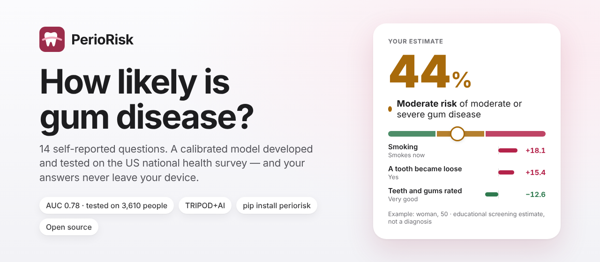
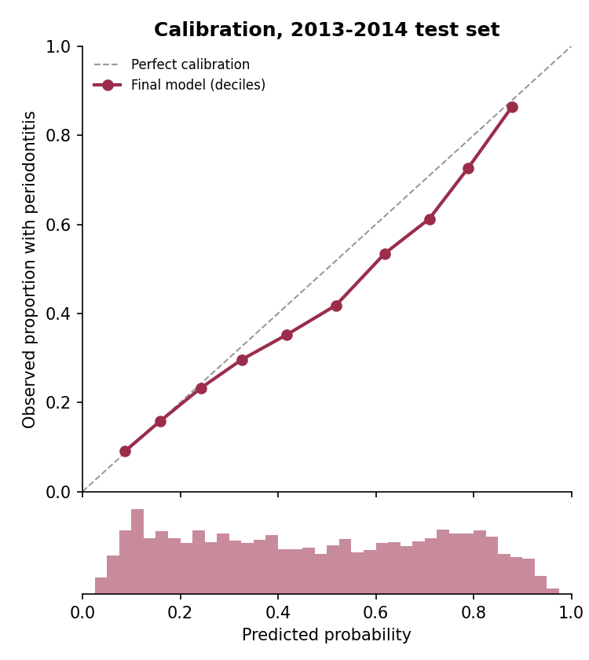
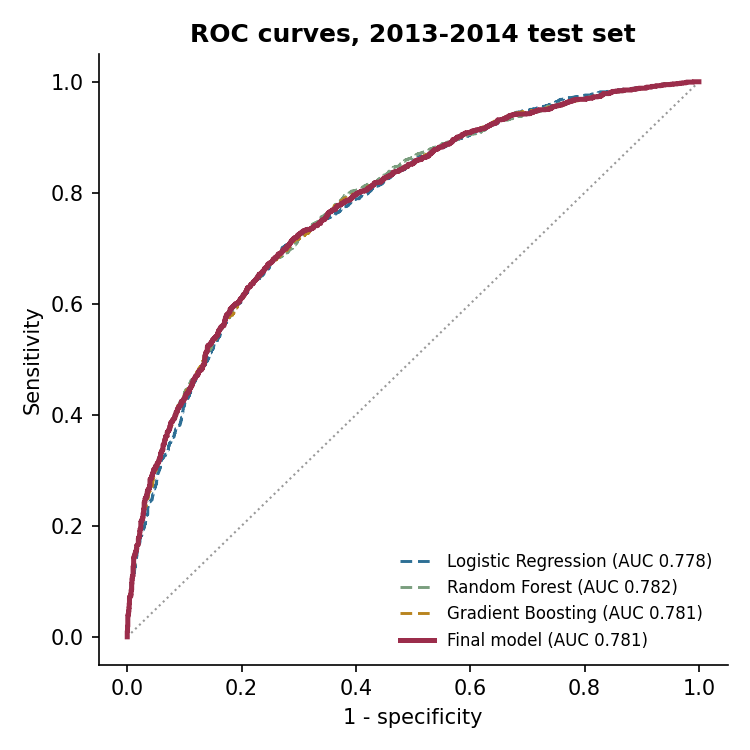
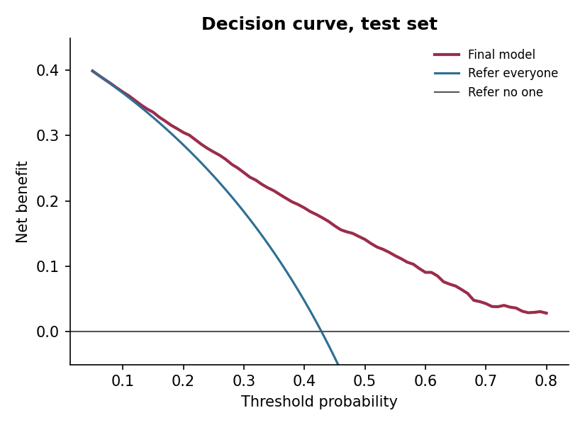

<p align="center">
  
</p>

# PerioRisk

**Periodontitis risk screening from 14 self-reported questions.** PerioRisk estimates a person's
probability of **moderate or severe periodontitis** (CDC/AAP surveillance case definition) from
questions anyone can answer without a dental examination. It was developed on NHANES 2009–2012,
tested once on the later NHANES 2013–2014 cycle, calibrated, checked for fairness and reported
following **TRIPOD+AI** — and it ships as a private in-browser app, a dependency-free Python
package and a one-command reproducible pipeline.

[](https://pypi.org/project/periorisk/)
[](https://pypi.org/project/periorisk/)
[](https://github.com/Hezarani/periorisk/blob/main/LICENSE)
[](https://github.com/Hezarani/periorisk/actions/workflows/tests.yml)
[](https://hezarani.github.io/periorisk/)
[](https://github.com/Hezarani/periorisk/blob/main/TRIPOD-AI.md)
[](https://doi.org/10.5281/zenodo.23813178)

> ⚠️ **Educational and research tool — not a diagnosis and not a medical device.** Only a
> periodontal examination with a probe can confirm gum disease. Anyone whose gums bleed, are swollen
> or whose teeth feel loose should see a dentist, whatever the estimate says.

---

## Why this exists

About **42% of US adults aged 30+ with teeth have periodontitis** and 7.8% have the severe form
(NHANES 2009–2014, Eke et al. 2018), yet it is often painless until late. The reference standard — a
full-mouth probing examination — needs a dental visit. Validated self-report questions can prompt
people to have that examination and let researchers estimate periodontitis in surveys that have no
examination (Eke et al. 2013, 2016, 2025).

Self-report models of periodontitis already exist — including the CDC's own scoring algorithm
(Eke et al. 2025) — and machine-learning models built on NHANES are common, although many are
evaluated on a random split of the same survey, include laboratory variables, report discrimination
only, or are not released in a usable form. PerioRisk does not claim better discrimination than
published self-report models (its AUC of 0.78 is in the same range). It is built to be **checked,
used and reused**:

- **Self-report only** — 14 questions that follow the NHANES wording; no blood tests, no exam.
- **Temporal validation** — developed on 2009–2012, tested once on the untouched 2013–2014 cycle.
- **Calibration, not just AUC** — calibration slope, calibration-in-the-large and observed/expected
  ratio with 95% CIs, decision-curve analysis and subgroup calibration.
- **Population-representative performance** — survey-weighted estimates with design-based
  confidence intervals (Rao–Wu bootstrap over the NHANES strata and PSUs).
- **Transportability, honestly** — a documented prevalence (prior-shift) adjustment for populations
  with a known prevalence, with its limits shown.
- **Exactly portable** — the fitted model is exported to plain JSON and re-implemented in pure
  Python and in JavaScript; both reproduce scikit-learn's probabilities for all 10,660 participants
  to within 1e-12, tested on every commit.
- **Private by design** — the web app runs entirely in the browser; answers never leave the device.
- **Bit-for-bit reproducible** — one command downloads the public data and rebuilds the same model.

## Three ways to use it

### 1. In your browser — for anyone

**[hezarani.github.io/periorisk](https://hezarani.github.io/periorisk/)** — answer the 14
questions (about two minutes) and see your estimate, what it means, which answers shaped it and
what to do next, with a one-page summary you can print for your dentist. Nothing is uploaded,
stored or tracked. The questions use the NHANES wording (two NHANES smoking questions are combined
into one, and education answers are grouped).

### 2. In Python — for researchers, apps and batch scoring

```bash
pip install periorisk            # Python 3.10+, no dependencies
```

```python
import periorisk

r = periorisk.predict(
    age=58, sex="male", height_cm=178, weight_kg=85,
    education="high_school", smoking="current", diabetes="no",
    gum_health="fair", gum_treatment="no", loose_teeth="yes", bone_loss="not_sure",
    tooth_doesnt_look_right="no", floss_days=0, mouthwash_days=0,
)
print(r.percent, r.band)          # e.g. 91 high
print(r.summary())                # plain-language result with the answers that moved it most

# research use: adjust to a population with a different prevalence (prior-shift adjustment)
periorisk.recalibrate(r.probability, target_prevalence=0.30)
```

Unanswered questions (or "not_sure") are filled with a typical answer from the training data (the
most common answer, or the median for numbers). `r.contributions` lists how much each answer moved
the estimate compared with that typical answer — a description of the model, not of cause and effect.
`periorisk.questionnaire()` lists every question with its NHANES source variable and allowed answers.

### 3. On the command line

```bash
periorisk predict --age 58 --sex male --smoking current --gum-health fair --loose-teeth yes --floss-days 0
periorisk batch answers.csv results.csv        # one row per person, columns named like the questions
periorisk questions                            # the questionnaire
periorisk info                                 # model version, population and performance
```

## Results (NHANES 2013–2014 temporal test set, n = 3,610)

95% CIs from 1,000 participant-level bootstrap resamples, except the survey-weighted rows, whose
design-based CIs (Rao–Wu bootstrap over strata and PSUs) are wider and more realistic.

| Measure | Estimate (95% CI) |
|---|---|
| AUC | **0.781** (0.766–0.796) |
| Sensitivity / specificity at the pre-specified threshold (0.47) | 0.734 (0.712–0.755) / 0.680 (0.658–0.702) |
| Positive / negative predictive value | 0.633 / 0.773 |
| Brier score | 0.190 (0.184–0.198) |
| Calibration slope (ideal 1) | 0.909 (0.839–0.979) |
| Observed / expected ratio (ideal 1) | 0.903 (0.874–0.935) |
| **Survey-weighted** AUC (US population 30+ with teeth) | 0.785 (0.760–0.807) |
| **Survey-weighted** observed / expected ratio | 0.799 (0.723–0.882) |

**Model comparison.** Logistic regression (AUC 0.778), random forest (0.782) and gradient boosting
(0.781) performed almost identically — consistent with the systematic finding that machine learning
rarely beats logistic regression on tabular clinical data (Christodoulou et al. 2019). Gradient
boosting was selected by the pre-specified rule (highest cross-validated AUC on the training data)
and calibrated with 5-fold sigmoid scaling.

**Risk bands used in the app.** Among test participants with an estimate **below 30%**, 16.9% had
moderate or severe periodontitis; **30–60%**: 37.4%; **60% or more**: 69.8%. Used as screening
rules, an estimate of 30% or more flagged 87% of people with the disease (specificity 47%), and 60%
or more flagged 60% (specificity 80%).

**Calibration and transportability.** Prevalence fell from 48.7% (2009–2012 sample) to 42.9%
(2013–2014), so the model over-estimates slightly in the test cycle (O/E 0.90), and more for the
US population as a whole once the survey weights undo NHANES's over-sampling (O/E 0.80).
`periorisk.recalibrate` re-weights the predicted odds to a known prevalence. Using the test cycle's
own prevalence it brings O/E to 0.99 — guaranteed by construction, so this only demonstrates the
mechanism — and it never changes discrimination. It is not a cure-all: adjusting to the
survey-weighted US prevalence (34.3%) over-corrects (weighted O/E 0.80 → 1.06), because that
miscalibration comes from who NHANES samples rather than from prevalence alone.

**Fairness.** Race/ethnicity is not an input. Test AUC by subgroup ranged 0.71–0.80 across sex, age
group, race/ethnicity, education and diabetes; it was lowest in people aged 65+ (0.73), with less
than high-school education (0.71) and with diabetes (0.72). Observed/expected ratios per group are
in the report.

Everything — cohort flow with exclusion reasons, participant characteristics, missing data, per-model
metrics, bootstrap and survey-weighted CIs, decision-curve table, subgroup calibration, a sensitivity
analysis and permutation importance — is in
**[reports/results.md](https://github.com/Hezarani/periorisk/blob/main/reports/results.md)**,
written automatically by the pipeline.

| Calibration | ROC curves | Decision curve |
|---|---|---|
|  |  |  |

## Data, outcome and predictors

- **Data:** NHANES 2009–2010, 2011–2012 and 2013–2014 (CDC/NCHS, public domain) — the three cycles
  with a full-mouth periodontal examination (six sites per tooth, all teeth except third molars).
- **Population:** adults aged 30+ with a complete periodontal examination and at least two teeth
  measured (n = 10,660; training 7,050, test 3,610).
- **Outcome:** moderate or severe periodontitis by the CDC/AAP case definition (Page & Eke 2007;
  Eke et al. 2012), from interproximal clinical attachment loss and probing depth. The labelling code
  reproduces the CDC's published survey-weighted prevalence (42.3% vs 42.2% any periodontitis;
  7.8% vs 7.8% severe; Eke et al. 2018).
- **Predictors (13 model inputs from 14 questions):** age, sex, body-mass index (from height and
  weight), education, cigarette smoking, diabetes, self-rated health of teeth and gums, past gum
  treatment, loose teeth, told of bone loss, a tooth that "doesn't look right", and days of
  interdental cleaning and of mouthwash use in the past week — the CDC/AAP self-report items
  (Eke & Dye 2009) plus standard risk factors. Race/ethnicity is used only to check fairness. The
  eighth CDC/AAP item ("Do you think you might have gum disease?") was not pre-specified; adding it
  raised cross-validated AUC slightly (0.803 → 0.807) and is a candidate for a future version.

The [model card](https://github.com/Hezarani/periorisk/blob/main/MODEL_CARD.md) covers intended use,
limits and fairness; the [TRIPOD+AI checklist](https://github.com/Hezarani/periorisk/blob/main/TRIPOD-AI.md)
maps every reporting item to where it is answered.

## Reproduce everything

```bash
git clone https://github.com/Hezarani/periorisk && cd periorisk
pip install -r requirements-training.txt     # exact versions used (Python 3.12)
python -m training                           # ~3 minutes on a laptop, no GPU
python -m pytest                             # 97 checks
```

`python -m training` downloads the 18 NHANES files (~95 MB) from the CDC, stores every step in a
local SQLite database (`data/perio.db`, see `sql/views.sql`), trains and evaluates the models,
rewrites `models/`, `reports/` and `data/processed/`, and exports the portable model to
`periorisk/data/model.json` and `docs/model.js` — refusing to write it unless it reproduces
scikit-learn's predictions for every participant. Re-running it gives byte-identical results.

## Repository structure

```
docs/                    web app (GitHub Pages): index.html, app.js, periorisk.js (engine), model.js
periorisk/               Python package: predict(), recalibrate(), CLI; data/model.json
training/                pipeline: download, clean (case definition), train, evaluate, export, run
sql/views.sql            summary views over the pipeline database
data/processed/          analytic dataset (CSV, one row per participant)
models/                  fitted scikit-learn model + metadata
reports/                 results.md, metrics.json, figures
tests/                   pytest suite (Python ⇄ scikit-learn ⇄ JavaScript parity, API, case definition)
MODEL_CARD.md · TRIPOD-AI.md · paper.md · CITATION.cff
```

## Limitations

- Developed and tested in the US population; performance in other countries is unknown and needs
  external validation (and, if prevalence differs, recalibration).
- Cross-sectional: it estimates current disease, not future risk.
- Self-reported answers can be wrong; body-mass index was measured in NHANES but is self-reported in the app.
- Model development did not use the survey weights; weighted results are reported for evaluation.
- Participants with a partial periodontal examination (210) were excluded.
- Not evaluated prospectively, in dental clinics, or with translated questionnaires.

## References & prior work

**Case definition, self-report measures and US prevalence (what PerioRisk builds on)**

- Page RC, Eke PI. Case definitions for use in population-based surveillance of periodontitis. *J Periodontol* 2007;78(7 Suppl):1387–1399. [doi:10.1902/jop.2007.060264](https://doi.org/10.1902/jop.2007.060264)
- Eke PI, Page RC, Wei L, Thornton-Evans G, Genco RJ. Update of the case definitions for population-based surveillance of periodontitis. *J Periodontol* 2012;83(12):1449–1454. [doi:10.1902/jop.2012.110664](https://doi.org/10.1902/jop.2012.110664)
- Eke PI, Dye B. Assessment of self-report measures for predicting population prevalence of periodontitis. *J Periodontol* 2009;80(9):1371–1379. [doi:10.1902/jop.2009.080607](https://doi.org/10.1902/jop.2009.080607)
- Eke PI, Dye BA, Wei L, et al. Self-reported measures for surveillance of periodontitis. *J Dent Res* 2013;92(11):1041–1047. [doi:10.1177/0022034513505621](https://doi.org/10.1177/0022034513505621)
- Eke PI, Zhang X, Lu H, et al. Predicting periodontitis at state and local levels in the United States. *J Dent Res* 2016;95(5):515–522. [doi:10.1177/0022034516629112](https://doi.org/10.1177/0022034516629112)
- Eke PI, Thornton-Evans GO, Wei L, Borgnakke WS, Dye BA, Genco RJ. Periodontitis in US adults: National Health and Nutrition Examination Survey 2009–2014. *J Am Dent Assoc* 2018;149(7):576–588.e6. [doi:10.1016/j.adaj.2018.04.023](https://doi.org/10.1016/j.adaj.2018.04.023)
- Centers for Disease Control and Prevention, National Center for Health Statistics. National Health and Nutrition Examination Survey data, 2009–2014. [wwwn.cdc.gov/nchs/nhanes](https://wwwn.cdc.gov/nchs/nhanes/)

**Closest prior and related work**

- Eke PI, Wei L, Thornton-Evans G, Borgnakke WS. Scoring algorithm for predicting periodontitis in dentate adults using self-report measures — NHANES 2009–2012. *Periodontol 2000* 2025;98(1):7–19. [doi:10.1111/prd.12624](https://doi.org/10.1111/prd.12624)
- Montero E, Herrera D, Sanz M, Dhir S, Van Dyke T, Sima C. Development and validation of a predictive model for periodontitis using NHANES 2011–2012 data. *J Clin Periodontol* 2019;46(4):420–429. [doi:10.1111/jcpe.13098](https://doi.org/10.1111/jcpe.13098)
- Bashir NZ, Rahman Z, Chen SL. Systematic comparison of machine learning algorithms to develop and validate predictive models for periodontitis. *J Clin Periodontol* 2022;49(10):958–969. [doi:10.1111/jcpe.13692](https://doi.org/10.1111/jcpe.13692)
- Vu GT, Mayya V, Mandhidi B, et al. Application of machine learning to predict periodontal disease in US adults: a cross-sectional analysis of NHANES 2009–2014. *Health Informatics J* 2025;31(4). [doi:10.1177/14604582251394617](https://doi.org/10.1177/14604582251394617)
- Verhulst MJL, Teeuw WJ, Bizzarro S, et al. A rapid, non-invasive tool for periodontitis screening in a medical care setting. *BMC Oral Health* 2019;19:87. [doi:10.1186/s12903-019-0784-7](https://doi.org/10.1186/s12903-019-0784-7)
- Viana J, Machado V, Lyra P, et al. External validation of periodontal screening using self-reports in dental settings. *Diagnostics* 2025;15(23):3015. [doi:10.3390/diagnostics15233015](https://doi.org/10.3390/diagnostics15233015)
- Bi M, Xie Y, Yu X, et al. Diagnostic accuracy of self-reported questionnaires for detecting periodontitis across multiple cultures and geographic locations: a systematic review and meta-analysis. *J Clin Periodontol* 2025;52(11):1510–1528. [doi:10.1111/jcpe.70002](https://doi.org/10.1111/jcpe.70002)

**Methods used**

- Collins GS, Moons KGM, Dhiman P, et al. TRIPOD+AI statement: updated guidance for reporting clinical prediction models that use regression or machine learning methods. *BMJ* 2024;385:e078378. [doi:10.1136/bmj-2023-078378](https://doi.org/10.1136/bmj-2023-078378)
- Van Calster B, McLernon DJ, van Smeden M, Wynants L, Steyerberg EW. Calibration: the Achilles heel of predictive analytics. *BMC Med* 2019;17:230. [doi:10.1186/s12916-019-1466-7](https://doi.org/10.1186/s12916-019-1466-7)
- Vickers AJ, Elkin EB. Decision curve analysis: a novel method for evaluating prediction models. *Med Decis Making* 2006;26(6):565–574. [doi:10.1177/0272989X06295361](https://doi.org/10.1177/0272989X06295361)
- Christodoulou E, Ma J, Collins GS, Steyerberg EW, Verbakel JY, Van Calster B. A systematic review shows no performance benefit of machine learning over logistic regression for clinical prediction models. *J Clin Epidemiol* 2019;110:12–22. [doi:10.1016/j.jclinepi.2019.02.004](https://doi.org/10.1016/j.jclinepi.2019.02.004)
- Saerens M, Latinne P, Decaestecker C. Adjusting the outputs of a classifier to new a priori probabilities: a simple procedure. *Neural Comput* 2002;14(1):21–41. [doi:10.1162/089976602753284446](https://doi.org/10.1162/089976602753284446)
- Rao JNK, Wu CFJ, Yue K. Some recent work on resampling methods for complex surveys. *Survey Methodology* 1992;18(2):209–217.
- Friedman JH. Greedy function approximation: a gradient boosting machine. *Ann Stat* 2001;29(5):1189–1232. [doi:10.1214/aos/1013203451](https://doi.org/10.1214/aos/1013203451)
- Breiman L. Random forests. *Mach Learn* 2001;45(1):5–32. [doi:10.1023/A:1010933404324](https://doi.org/10.1023/A:1010933404324)
- Youden WJ. Index for rating diagnostic tests. *Cancer* 1950;3(1):32–35. [doi:10.1002/1097-0142(1950)3:1<32::AID-CNCR2820030106>3.0.CO;2-3](https://doi.org/10.1002/1097-0142(1950)3:1%3C32::AID-CNCR2820030106%3E3.0.CO;2-3)
- Pedregosa F, Varoquaux G, Gramfort A, et al. Scikit-learn: machine learning in Python. *J Mach Learn Res* 2011;12:2825–2830.

## Citation and licence

If you use PerioRisk, please cite it (or use GitHub's **"Cite this repository"** button, from
[`CITATION.cff`](https://github.com/Hezarani/periorisk/blob/main/CITATION.cff)):

> Boustani Hezarani H. *PerioRisk: periodontitis risk screening from self-reported questions*
> (software). Zenodo; 2026. [doi:10.5281/zenodo.23813178](https://doi.org/10.5281/zenodo.23813178)

```bibtex
@software{boustani_hezarani_periorisk,
  author    = {Boustani Hezarani, Hossein},
  title     = {{PerioRisk: periodontitis risk screening from self-reported questions}},
  year      = {2026},
  publisher = {Zenodo},
  version   = {1.0.0},
  doi       = {10.5281/zenodo.23813178},
  url       = {https://doi.org/10.5281/zenodo.23813178}
}
```

The DOI above always points to the latest version. Version 1.0.0 itself is
[doi:10.5281/zenodo.23813179](https://doi.org/10.5281/zenodo.23813179).

Code: MIT License © 2026 Hossein Boustani Hezarani, DDS
([ORCID 0009-0007-8481-0498](https://orcid.org/0009-0007-8481-0498)). NHANES data: public domain
(CDC/NCHS). Part of the open **DentGit** dental tools: ToothNotation, OraCalm, DentRx, OdontoAge, DentDeID.
