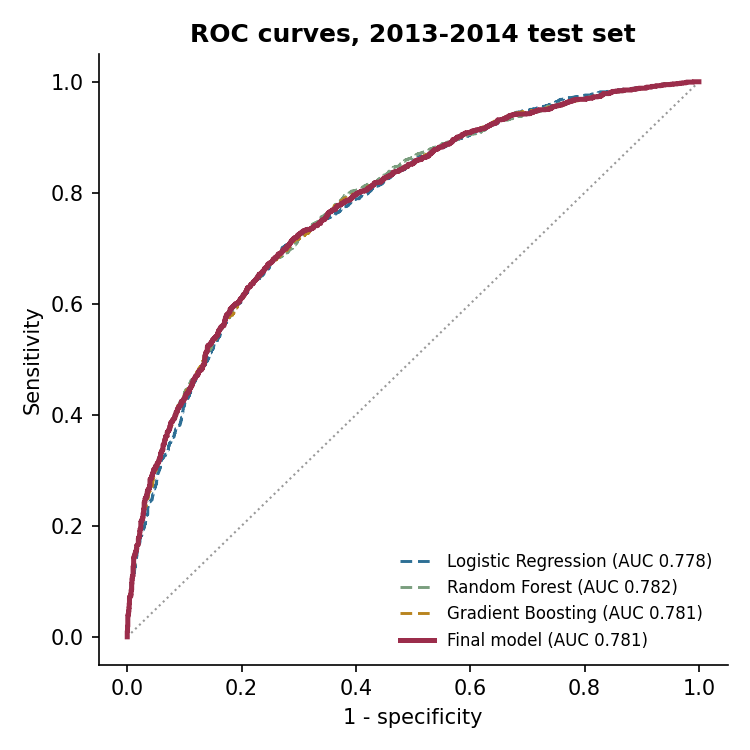
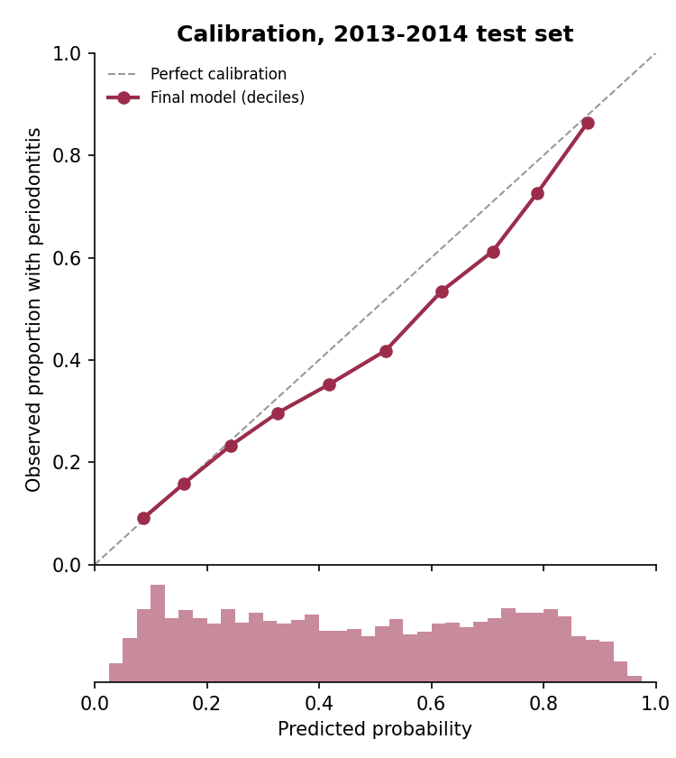
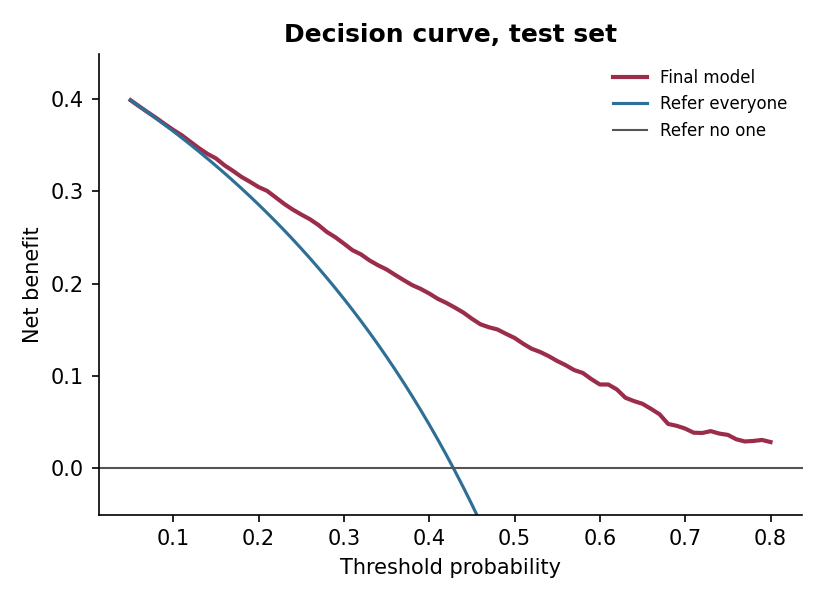
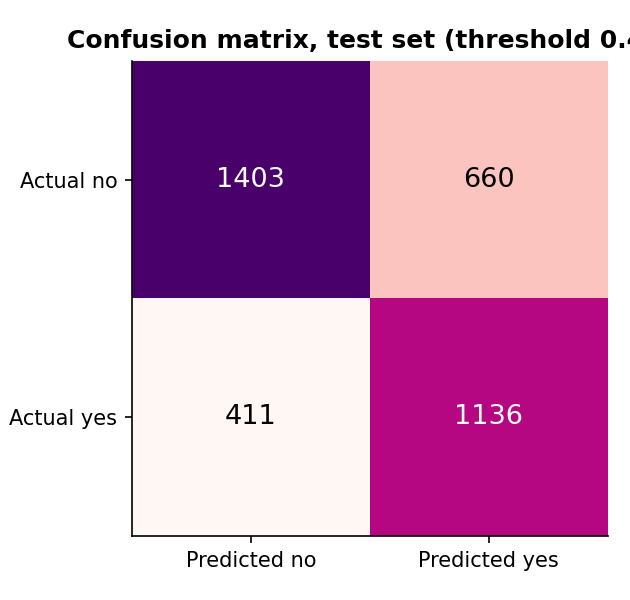
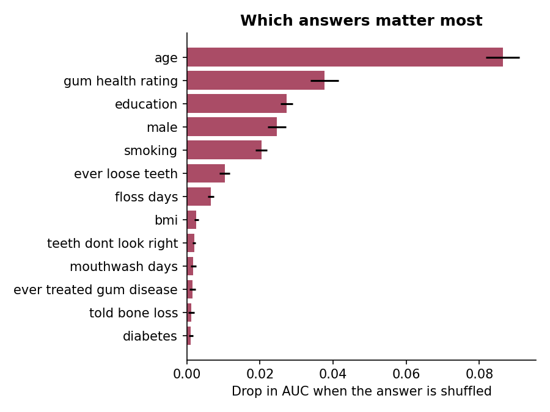

# Results report

_This file is written automatically by `python -m training`. Do not edit by hand._

## Study population

- Participants in the periodontal exam files (aged 30+): 14,071
- Excluded, exam partial: 210; exam not done: 2,108
- With a complete periodontal exam: 11,753 (all aged 30 or older: 11,753)
- Excluded, no teeth measured (edentulous): 1,070; only one tooth measured: 23
- With at least 2 teeth measured (analytic sample): 10,660
- Development set (2009-2012): 7,050, of whom 3,430 had moderate or severe periodontitis / Evaluation set (2013-2014): 3,610, of whom 1,547

Survey-weighted prevalence in the analytic sample (check of the case-definition code against the CDC's published NHANES 2009-2014 estimates of 42.2% and 7.8%, Eke et al. 2018):

- Any periodontitis: 42.3%
- Moderate or severe: 38.0%
- Severe: 7.8%

## Participant characteristics (unweighted)

| Characteristic | Development 2009-2012 | Evaluation 2013-2014 |
|---|---|---|
| Participants, n | 7,050 | 3,610 |
| Moderate or severe periodontitis, n (%) | 3,430 (48.7%) | 1,547 (42.9%) |
| Age, years, mean (SD) | 52.0 (14.3) | 52.0 (14.3) |
| Male, % | 49.7 | 48.4 |
| Body-mass index, mean (SD) | 29.3 (6.5) | 29.4 (7.0) |
| Education: less than high school / high school / more, % | 25.2 / 21.4 / 53.4 | 19.7 / 21.7 / 58.6 |
| Smoking: never / former / current, % | 56.1 / 25.0 / 18.9 | 56.6 / 25.0 / 18.4 |
| Diabetes: no / borderline / yes, % | 85.5 / 2.3 / 12.2 | 83.7 / 3.3 / 13.0 |
| Teeth and gums rated fair or poor, % | 33.8 | 33.5 |
| Ever treated for gum disease, % | 24.1 | 23.9 |
| Ever had a tooth loosen on its own, % | 15.5 | 15.4 |
| Told of bone loss around teeth, % | 12.3 | 13.0 |
| Noticed a tooth that doesn't look right, % | 17.4 | 17.3 |
| Days cleaning between teeth (0-7), mean (SD) | 3.2 (3.0) | 3.4 (2.9) |
| Days using mouthwash for dental problems (0-7), mean (SD) | 3.1 (3.1) | 3.1 (3.1) |

### Missing answers (filled by the model's imputation)

| Model input | Development, % missing | Evaluation, % missing |
|---|---|---|
| age | 0.00 | 0.00 |
| bmi | 0.64 | 0.53 |
| gum health rating | 1.23 | 0.06 |
| floss days | 1.19 | 0.03 |
| mouthwash days | 1.19 | 0.00 |
| male | 0.00 | 0.00 |
| ever treated gum disease | 1.55 | 0.28 |
| ever loose teeth | 1.19 | 0.06 |
| told bone loss | 1.76 | 0.53 |
| teeth dont look right | 1.23 | 0.11 |
| education | 0.16 | 0.06 |
| smoking | 0.04 | 0.06 |
| diabetes | 0.07 | 0.03 |
| any of the above | 3.19 | 1.50 |

## Model comparison (test set 2013-2014)

Each candidate is scored at its own screening threshold (Youden's J on its out-of-fold training predictions). The candidates are the uncalibrated models refit on all training data.

| Model | CV AUC (train) | Test AUC (95% CI) | Threshold | Sensitivity | Specificity | Brier |
|---|---|---|---|---|---|---|
| Logistic Regression | 0.800 | 0.778 (0.762-0.792) | 0.453 | 0.741 | 0.679 | 0.191 |
| Random Forest | 0.800 | 0.782 (0.767-0.796) | 0.490 | 0.731 | 0.688 | 0.191 |
| Gradient Boosting | 0.803 | 0.781 (0.766-0.795) | 0.462 | 0.744 | 0.668 | 0.190 |
| **Final model: Gradient Boosting + sigmoid calibration** | - | **0.781 (0.766-0.796)** | 0.470 | 0.734 | 0.680 | 0.190 |

Selected model: **Gradient Boosting** (highest cross-validated AUC on the training data), calibrated with 5-fold sigmoid (Platt) scaling.
Screening threshold chosen on training data only (Youden's J): **0.470**

## Final model on the test set

95% confidence intervals: 1,000 participant-level bootstrap resamples. These ignore the NHANES cluster design and are therefore narrower than design-based intervals (compare the survey-weighted section below).

| Measure | Estimate | 95% CI |
|---|---|---|
| AUC (discrimination) | 0.781 | 0.766-0.796 |
| Sensitivity | 0.734 | 0.712-0.755 |
| Specificity | 0.680 | 0.658-0.702 |
| Positive predictive value | 0.633 | 0.609-0.657 |
| Negative predictive value | 0.773 | 0.753-0.792 |
| Brier score (lower is better) | 0.190 | 0.184-0.198 |
| Scaled Brier score | 0.222 | |
| Observed / expected ratio (ideal 1) | 0.903 | 0.874-0.935 |
| Calibration-in-the-large (ideal 0) | -0.254 | -0.332--0.171 |
| Calibration slope (ideal 1) | 0.909 | 0.839-0.979 |
| Accuracy | 0.703 | |
| F1 score | 0.680 | |

## Population-representative performance (survey-weighted)

Weighted with the NHANES examination weights, so the estimates describe the US adult population aged 30+ with teeth rather than the (over-sampled) survey sample. 95% CIs: Rao-Wu rescaling bootstrap over 15 strata (1000 replicates).

| Measure | Estimate | 95% CI |
|---|---|---|
| Prevalence of moderate/severe periodontitis | 0.343 | 0.301-0.394 |
| AUC | 0.785 | 0.760-0.807 |
| Sensitivity | 0.700 | 0.670-0.728 |
| Specificity | 0.725 | 0.702-0.745 |
| Positive predictive value | 0.571 | 0.527-0.617 |
| Negative predictive value | 0.822 | 0.780-0.854 |
| Accuracy | 0.716 | 0.696-0.734 |
| Brier score | 0.182 | 0.172-0.194 |
| Observed / expected ratio | 0.799 | 0.723-0.882 |
| Calibration-in-the-large | -0.487 | -0.672--0.291 |
| Calibration slope | 0.972 | 0.866-1.074 |

## Risk bands used in the app

| Band | Predicted probability | People in test set | Mean predicted | Actually had periodontitis |
|---|---|---|---|---|
| low | below 30% | 1,157 | 17.1% | 16.9% |
| moderate | 30% to 60% | 1,115 | 44.5% | 37.4% |
| high | 60% or more | 1,338 | 76.2% | 69.8% |

Using the band cut-offs as screening rules: an estimate of 30% or more flagged 87.3% of people with moderate or severe periodontitis (specificity 46.6%); an estimate of 60% or more flagged 60.4% (specificity 80.4%).

## Clinical usefulness (decision curve)

Net benefit = true positives found per person screened, minus false positives weighted by the odds of the threshold (Vickers & Elkin 2006).

| Threshold probability | Model | Refer everyone |
|---|---|---|
| 20% | 0.305 | 0.286 |
| 30% | 0.243 | 0.184 |
| 40% | 0.189 | 0.048 |
| 50% | 0.141 | -0.143 |

## Transportability: adjusting to a population's prevalence

Prevalence fell from 48.7% (2009-2012) to 42.9% (2013-2014). Re-weighting the predicted odds to a known prevalence (prior-shift adjustment, Saerens et al. 2002; available in the package as `periorisk.recalibrate`) shows what a user with a reliable local prevalence estimate can expect. Here the test-set prevalence itself is used, so this is a demonstration of the mechanism, not an independent validation.

| | Observed / expected | Calibration-in-the-large | Calibration slope | AUC |
|---|---|---|---|---|
| As trained | 0.903 | -0.254 | 0.909 | 0.781 |
| Adjusted to 42.9% | 0.992 | -0.020 | 0.909 | 0.781 |

A prevalence adjustment cannot fix every kind of miscalibration. Adjusting to the survey-weighted US prevalence (34.3%) moves the survey-weighted observed/expected ratio from 0.80 to 1.06 (an over-correction), because the population-level miscalibration comes mainly from NHANES's over-sampling of higher-risk groups (a change in who is surveyed), not from a change in prevalence alone.

## Performance in subgroups (fairness check)

Observed / expected below 1 means the model over-estimates risk in that group; above 1, under-estimates. Race/ethnicity is not a model input.

| Group | Level | n | Prevalence | Mean predicted | Observed / expected | AUC |
|---|---|---|---|---|---|---|
| sex | Female | 1,864 | 35.1% | 39.7% | 0.89 | 0.761 |
| sex | Male | 1,746 | 51.1% | 55.8% | 0.92 | 0.781 |
| age group | 30-44 | 1,315 | 29.9% | 27.3% | 1.09 | 0.749 |
| age group | 45-64 | 1,509 | 46.8% | 53.9% | 0.87 | 0.800 |
| age group | 65+ | 786 | 57.0% | 68.7% | 0.83 | 0.732 |
| race ethnicity | Mexican American | 491 | 56.0% | 53.9% | 1.04 | 0.747 |
| race ethnicity | Non-Hispanic Black | 704 | 54.4% | 51.3% | 1.06 | 0.787 |
| race ethnicity | Non-Hispanic White | 1,556 | 35.0% | 46.1% | 0.76 | 0.795 |
| race ethnicity | Other / multiracial | 538 | 38.1% | 39.5% | 0.97 | 0.765 |
| race ethnicity | Other Hispanic | 321 | 43.3% | 49.0% | 0.88 | 0.760 |
| education | high school | 782 | 52.3% | 56.0% | 0.93 | 0.770 |
| education | less than high school | 711 | 63.9% | 65.2% | 0.98 | 0.713 |
| education | more than high school | 2,115 | 32.2% | 38.3% | 0.84 | 0.759 |
| diabetes | borderline | 119 | 51.3% | 56.9% | 0.90 | 0.737 |
| diabetes | no | 3,021 | 40.0% | 44.7% | 0.89 | 0.781 |
| diabetes | yes | 469 | 59.5% | 63.0% | 0.94 | 0.721 |

## Sensitivity analysis: an eighth CDC/AAP self-report item

The CDC/AAP self-report set also includes "Do you think you might have gum disease?" (OHQ835). Adding it to the selected model configuration was checked by 5-fold cross-validation on the development data only: AUC 0.8032 without it vs 0.8067 with it. The gain is small; version 1.0.0 keeps the pre-specified 14-question set, and the item is a candidate for a future version.

## Most influential answers (permutation importance)

| Answer | Drop in AUC when shuffled |
|---|---|
| age | 0.0864 |
| gum health rating | 0.0376 |
| education | 0.0273 |
| male | 0.0246 |
| smoking | 0.0204 |
| ever loose teeth | 0.0103 |
| floss days | 0.0065 |
| bmi | 0.0026 |
| teeth dont look right | 0.0020 |
| mouthwash days | 0.0018 |
| ever treated gum disease | 0.0016 |
| told bone loss | 0.0012 |
| diabetes | 0.0011 |

## Figures

